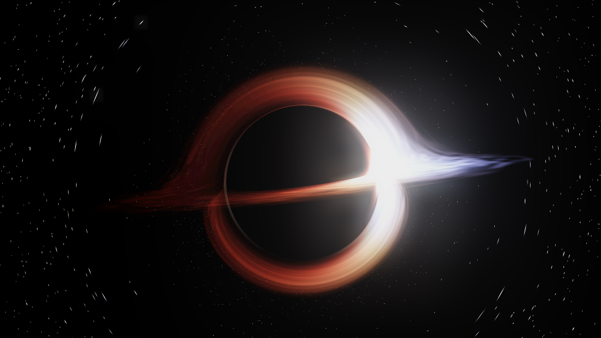
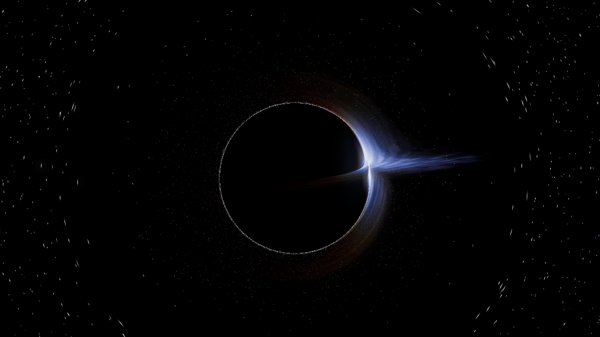

# Black Hole Screensaver

Turn the Interstellar "Gargantua" black hole into your Linux screensaver — not a looping video, but a real-physics black hole rendered live on your GPU every frame.

## Why it is special

- Not a video. Light rays are bent by real-time geodesic integration in the Schwarzschild metric (u'' = -u + 1.5·rs·u²), so the lensed Einstein ring, the warped accretion disk (top & bottom arcs) and the starfield are genuinely simulated.
- Relativistic beaming (the approaching side is brighter and bluer) and Doppler + gravitational redshift — the same effects seen in real black-hole imagery.
- Near-zero idle cost: a tiny daemon idles in the background; the heavy 3D render only starts when you lock the screen or walk away, and quits the moment you return.

## Features

- Real gravitational lensing via Schwarzschild geodesic integration
- Accretion disk with relativistic beaming (I ∝ g³) and chromatic Doppler / gravitational redshift
- Lensed Einstein-ring star field (toggleable) with 3 quality tiers
- DE-independent daemon: auto-launches full-screen on idle/lock across Cinnamon, KDE, GNOME, Xfce and MATE; Esc dismisses it (other keys are live shortcuts; mouse movement is ignored)
- Safe on both X11 and Wayland (on Wayland the window appears gracefully beneath/before the lock screen — never crashes)
- Live controls: distance, disk brightness, star lensing, auto camera, pause, quality

## Install (one command)

    git clone https://github.com/Wian1977/blackholescreensaver.git
    cd blackholescreensaver
    ./install.sh

Then lock your screen or wait about 5 minutes and the black hole appears. To preview immediately: python3 bh_gl.py (press Esc to quit).

Dependencies are auto-detected by the installer: python3-gi, gir1.2-gtk-3.0, python3-xlib, Mesa/OpenGL. Prefer a system-wide install? Grab the .deb from the Releases page and run sudo dpkg -i blackhole-screensaver_*.deb.

### Other install options

**Debian / Ubuntu / Linux Mint (.deb)** — download `blackhole-screensaver_<ver>_all.deb` from [Releases](https://github.com/Wian1977/blackholescreensaver/releases/tag/v1.1.0):

    sudo apt install ./blackhole-screensaver_*.deb

**apt repository (auto-updating)**:

    echo "deb [trusted=yes] https://wian1977.github.io/blackholescreensaver/ ./" | sudo tee /etc/apt/sources.list.d/blackhole.list
    sudo apt update && sudo apt install blackhole-screensaver

**AppImage (single file, cross-distro)** — download `BlackHoleScreensaver-<ver>-x86_64.AppImage`, make it executable and run:

    chmod +x BlackHoleScreensaver-*.AppImage
    ./BlackHoleScreensaver-*.AppImage --windowed

Without arguments it runs full-screen; `--windowed` opens a 1280x720 window for preview/recording. The host needs python3 + PyGObject + GTK3 + Mesa (the same deps `install.sh` checks for).

**Arch Linux (AUR)** — `aur/PKGBUILD` and `.SRCINFO` are ready; package name `blackhole-screensaver` (AUR upload pending).

## Desktop support

| Desktop | Status |
|---|---|
| Linux Mint Cinnamon (X11) | Full support; visible in screensaver picker |
| Xfce / MATE | Full support; visible in screensaver picker |
| KDE (X11) | Auto-triggered by daemon (KDE does not read the XDG screensaver dir, so not selectable in Settings) |
| GNOME (X11 / Wayland) | Auto-triggered by daemon |
| Wayland (KDE / GNOME) | Graceful degradation: window appears beneath/before the lock screen, never crashes |
| Minimal WM | Falls back to X11 idle polling (X11 + DISPLAY only) |

## Controls

H help · M auto camera · L star lensing · Space pause · B disk brightness · 1/2/3 quality · [ ] distance · Esc quit

## Architecture

- bh_gl.py: render core (GTK3 + OpenGL full-screen; works on X11 and Wayland)
- blackhole-daemon.py: DE-independent daemon (FreeDesktop / per-DE lock-screen DBus; X11 idle fallback; lazy Xlib import)
- shaders.py / lenslut.py / stars.py / bloom.py: render helpers
- lens_lut.bin: starfield lensing LUT

## Limitations

- Wayland lock-screen occlusion: under the generic approach the lock screen covers the window (graceful, no crash). Forced lock-screen coverage needs ext-session-lock-v1 / layer-shell / a KDE lock-screen plugin (future work).
- Windows / macOS: the render core can be run manually, but there is no screensaver integration.

## License

MIT — see LICENSE.
