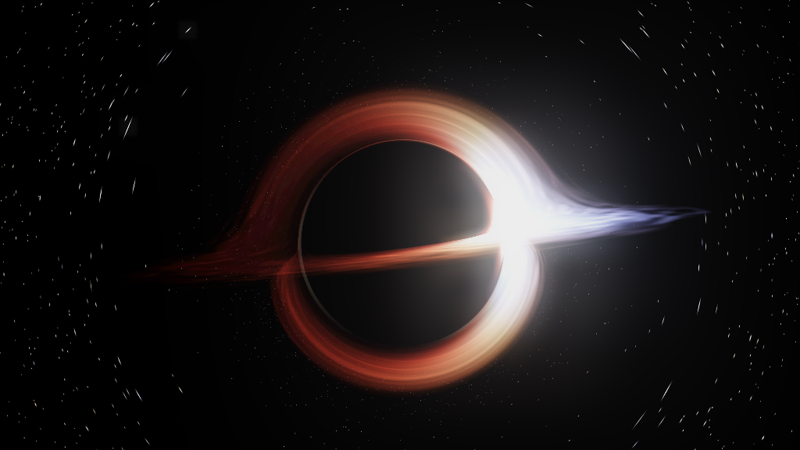
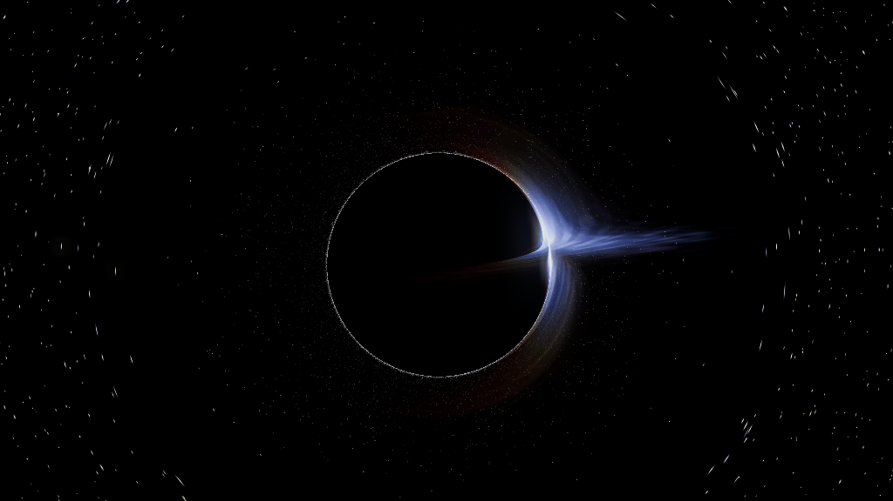

# Black Hole Screensaver · 黑洞屏保

English version / 英文版：[README.en.md](README.en.md)

把《星际穿越》里的 Gargantua 黑洞变成你的 Linux 屏保 —— 不是循环视频，而是每一帧都由 GPU 实时演算的真实物理黑洞。

This is a native OpenGL Linux screensaver that renders a real Schwarzschild black hole. Every frame is computed live on your GPU via geodesic light-bending — not a pre-rendered clip, not a looping video.

## 为什么值得装 / Why it is special

- 不是录屏、不是贴图。光线按史瓦西度规实时测地线积分偏折（u'' = -u + 1.5·rs·u²），爱因斯坦环、被透镜扭曲的吸积盘（上下弧）、星空全部是物理模拟的结果。
- 含相对论聚束（朝向侧更亮更蓝）、多普勒 + 引力红移 —— 和真实黑洞影像一致的效果。
- 零空闲开销：平时只有一个轻量守护进程；只有锁屏或空闲时才拉起全屏 OpenGL 渲染，你一回来立刻退出。

- Not a video. Light is bent by real-time geodesic integration in the Schwarzschild metric, so the lensed Einstein ring, the warped disk (top & bottom arcs) and the starfield are genuinely simulated.
- Relativistic beaming (approaching side brighter/bluer) and Doppler + gravitational redshift — the same effects seen in real black-hole imagery.
- Near-zero idle cost: a tiny daemon idles in the background; the heavy 3D render only starts when you lock the screen or walk away, and quits the moment you return.

## 特性 / Features

- 真实引力透镜：史瓦西测地线积分（u'' = -u + 1.5·rs·u²）
- 吸积盘相对论聚束（I 正比于 g 的三次方）+ 多普勒 / 引力红移（蓝近红远）
- 星空透镜爱因斯坦环（可开关）+ 3 档画质
- DE 无关守护进程：空闲 / 锁屏时在 Cinnamon、KDE、GNOME、Xfce、MATE 全平台自动全屏启动，任意输入即退出
- X11 与 Wayland 都安全（Wayland 下窗口优雅出现在锁屏之下或之前，不崩溃）
- 实时调控：距离、盘面亮度、星空透镜、自动运镜、暂停、画质

## 安装（一条命令）/ Install

    git clone https://github.com/Wian1977/blackholescreensaver.git
    cd blackholescreensaver
    ./install.sh

然后锁屏，或空闲约 5 分钟，黑洞就会出现。想立刻预览：python3 bh_gl.py（按 Esc 退出）。

Dependencies are auto-detected by the installer: python3-gi, gir1.2-gtk-3.0, python3-xlib, Mesa/OpenGL. Prefer a system-wide install? Grab the .deb from the Releases page and run sudo dpkg -i blackhole-screensaver_*.deb.

## 支持的桌面 / Desktop support

| 桌面 DE | 状态 |
|---|---|
| Linux Mint Cinnamon (X11) | 完整支持，屏保选择器可见 |
| Xfce / MATE | 完整支持，屏保选择器可见 |
| KDE (X11) | 守护进程自动触发（KDE 不读 XDG 屏保目录，无法在设置里手动选） |
| GNOME (X11 / Wayland) | 守护进程自动触发 |
| Wayland (KDE / GNOME) | 优雅降级：窗口出现在锁屏之下或之前，不崩溃 |
| 精简 WM | 退回 X11 空闲轮询（仅 X11 且有 DISPLAY 时） |

## 快捷键 / Controls

H 帮助 · M 自动运镜 · L 星空透镜 · Space 暂停 · B 盘面亮度 · 1/2/3 画质 · [ ] 距离 · Esc 退出

## 架构 / Architecture

- bh_gl.py：渲染核心（GTK3 + OpenGL 全屏，X11 / Wayland 均可用）
- blackhole-daemon.py：DE 无关守护进程（FreeDesktop / 各桌面锁屏 DBus 触发；X11 空闲回退；Xlib 惰性导入）
- shaders.py / lenslut.py / stars.py / bloom.py：渲染辅助
- lens_lut.bin：星空透镜 LUT（须与盘几何 rs/r0 一致）

## 已知限制 / Limitations

- Wayland 锁屏遮挡：通用方案下锁屏会盖住黑洞窗口（已优雅降级，不崩溃）；若要 Wayland 强制覆盖锁屏，需 ext-session-lock-v1 / layer-shell / KDE 锁屏插件（待做）。
- Windows / macOS：渲染核心可手动跑，但无屏保整合。

## License

MIT — see LICENSE.
