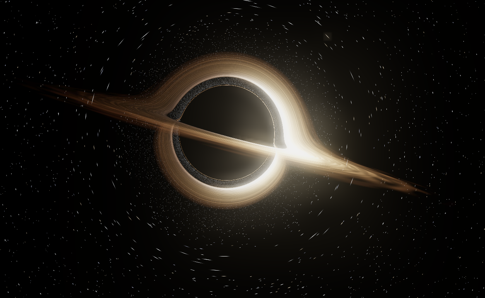

# Black Hole Screensaver 黑洞屏保



> **EN** — A black-hole screensaver simulated with **real physical parameters**: light rays are bent by real-time geodesic integration in the Schwarzschild metric; the accretion disk, relativistic beaming, and Doppler/gravitational redshift are all physically derived — not textures or fake effects.
>
> **中文** — 基于**真实物理参数**的施瓦西（Schwarzschild）黑洞屏保：光线按史瓦西度规实时测地线偏折，含吸积盘、相对论聚束与多普勒/引力红移，并非贴图或假特效。

---

## Features 特性

- **DE-independent** — works on any X11 desktop (Cinnamon / Xfce / MATE / GNOME / KDE) without depending on any desktop's screensaver framework.
- **Idle auto-fullscreen** — launches on X idle and stays under the lock screen; quits on any user input or unlock.
- **Zero GPU load when idle** — only a lightweight X-idle poll + DBus lock listener run in the background.
- **DE 无关** — 任意 X11 桌面通用（不绑定任何 DE 的屏保框架）。
- **空闲自动全屏**，锁屏时留在锁屏界面之下，有输入即退出。
- **平时零 GPU 负载**（仅轻量轮询 X 空闲 + 监听锁屏 DBus）。

## Physics (real parameters) 物理 / 真实参数

All optics come from a live numerical integration of a Schwarzschild black hole:

- **Gravitational lensing 引力透镜** — null geodesics are traced backward in the Schwarzschild metric. With `u = 1/r`, the orbit equation is `u'' = -u + 1.5·rs·u²`. Whenever a ray crosses the disk plane it is sampled, so the "hat brim", the Einstein ring, and the secondary images are direct consequences of real bending.
- **Accretion disk 吸积盘** — Keplerian differential rotation, inner edge at the ISCO; brightness follows relativistic beaming `I ∝ g³` (k=3), so the approaching side brightens and the receding side dims.
- **Redshift 红移** — the Doppler factor `δ = 1/(γ·(1−β·cosψ))` and the gravitational redshift `√(1−rs/r)` combine into `g`, which directly drives the color temperature: blueshift on the approaching side, redshift on the receding side.
- **Star lensing 星空透镜** — background stars are mapped through a gravitational-lensing LUT onto the Einstein ring and secondary images.

## Requirements 依赖

- `python3`, PyGObject (`python3-gi`) + GTK3, `python3-xlib`, Mesa / OpenGL
- Debian / Ubuntu / Mint:
  ```bash
  sudo apt install python3-gi python3-xlib gir1.2-gtk-3.0
  ```

## Install 安装

```bash
./install.sh
```

**Debian / Ubuntu / Mint (recommended)** — grab the `.deb` from [Releases](https://github.com/Wian1977/blackhole-screensaver/releases/tag/v1.0) and install:
```bash
sudo dpkg -i blackhole-screensaver_1.0.0_all.deb
```
This installs system-wide to `/usr/share/blackhole-screensaver`, adds desktop entries, and auto-starts the daemon on login.  
**其他发行版 / 源码安装**: 用下面的 `./install.sh` 装到用户目录。

This copies the app to `~/.local/share/blackhole-screensaver/`, registers a session **autostart**, and (on Xfce/MATE) a native screensaver entry. A menu item (Graphics) and a Desktop shortcut are also created.

装到 `~/.local/share/blackhole-screensaver/`，注册登录自启，并在 Xfce/MATE 注册原生屏保项，同时生成菜单项与桌面快捷方式。

## Usage 使用

- **Manual fullscreen 手动全屏**: `python3 bh_gl.py` — press **Esc** to quit.
- **Daemon status 守护状态**: `python3 blackhole-daemon.py --status`
- **Change idle threshold 改阈值**: `python3 blackhole-daemon.py --idle 3` (minutes)
- **Uninstall 卸载**: `./install.sh --uninstall`

Environment overrides: `IDLE_MIN` (default 5) and `BH_GL` (path to `bh_gl.py`).

### Keyboard shortcuts 快捷键（运行中）

| Key | Action (EN) | 动作（中文） |
|-----|-------------|--------------|
| `H` | Toggle this help overlay | 显示 / 隐藏本帮助 |
| `M` | Toggle auto camera motion | 自动运镜 开 / 关 |
| `L` | Toggle star gravitational lensing | 星空引力透镜 开 / 关 |
| `Space` | Pause / resume | 暂停 / 继续 |
| `S` | Mute / unmute sound | 声音 静音 / 开 |
| `1` / `2` / `3` | Quality: high / medium / low | 画质 高 / 中 / 低 |
| `[` / `]` | Camera distance: farther / nearer | 距离 远 / 近 |
| `B` | Toggle accretion-disk brightness | 盘面亮度 开 / 关 |
| `Esc` | Quit (manual mode) | 退出（手动模式） |

> Note: clicking the window does **not** quit (this avoids accidental dismissal); use `Esc`. 点击窗口不会退出，用 `Esc` 退出。

### Quality levels 画质等级

| Level | Stars (approx.) | Disk res | Ray steps |
|-------|-----------------|----------|-----------|
| High 高 | ~32,000 | 1.0× | 512 |
| Medium 中 | ~12,000 | 0.5× | 256 |
| Low 低 | ~4,000 | 0.5× | 256 |

## Desktop integration 各桌面适配

- **Xfce / MATE** — select "Black Hole" in Screensaver settings (driven by xfce4-screensaver / mate-screensaver).
- **Cinnamon** — daemon fallback (Cinnamon's screensaver framework can't be subclassed).
- **GNOME** — no native choice; daemon fallback.
- **KDE** — X11 session via daemon (idle trigger + freedesktop/kde lock signals); Wayland KDE not yet supported.
- **Generic** — the daemon watches X idle + lock signals, so any X11 DE works automatically.

## Limitations 已知限制

- **X11 only.** Wayland (the default for modern GNOME/KDE) is unsupported: Xlib can't read the true idle time and X11 fullscreen can't cover the lock screen. Requires logind/portal idle detection + compositor takeover (planned).
- **Windows / macOS** — the GTK3+OpenGL core can run manually but there is no screensaver integration.
- **仅支持 X11 会话**。Wayland 下（现代 GNOME/KDE 默认）无法工作，需改用 logind/portal 空闲检测与合成器接管（待做）。
- **Windows / macOS** 亦不支持（渲染核心可手动运行，但无屏保整合）。

## Architecture 架构

- `bh_gl.py` — render core (GTK3 + OpenGL fullscreen, DE-independent)
- `blackhole-daemon.py` — DE-independent screensaver daemon (X idle + lock DBus)
- `blackhole.desktop.in` — screensaver registration template
- `shaders.py`, `lenslut.py`, `stars.py`, `bloom.py` — rendering helpers
- `lens_lut.bin` — baked star-lensing lookup table (must match disk geometry `rs/r0`)

## License 许可证

MIT — see `LICENSE`.

## Roadmap 计划

- Wayland support via `ext-session-lock-v1` (KDE/GNOME Wayland sessions)
- Native KDE QML plugin (wallpaper/lock), installable via KDE Store / GHNS
- Flathub (Flatpak) packaging → KDE Discover / GNOME Software
- Distribution channel: GitHub Releases + `.deb` (see `store/`)
